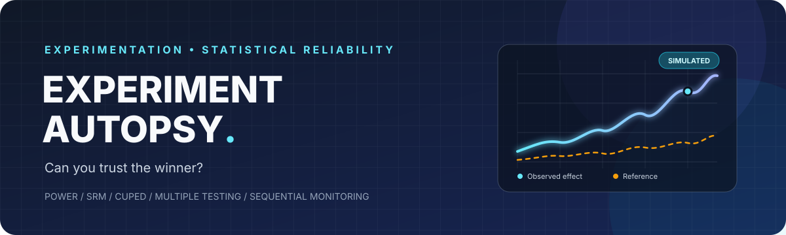
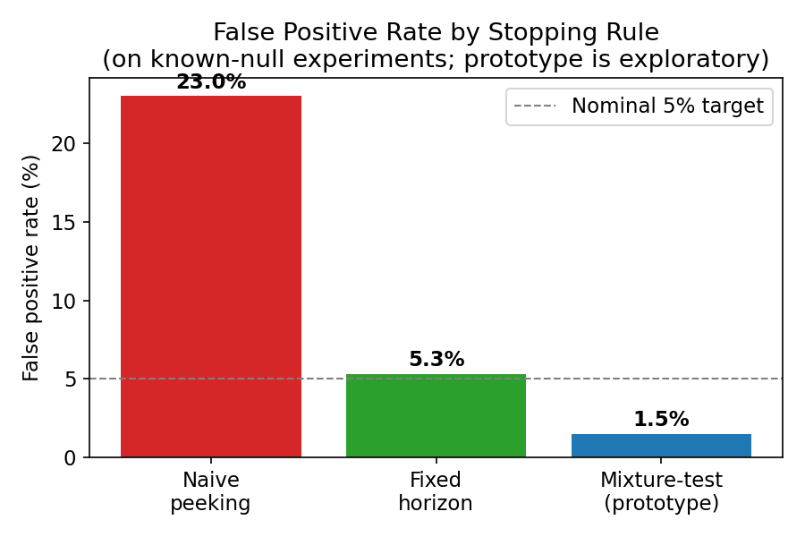
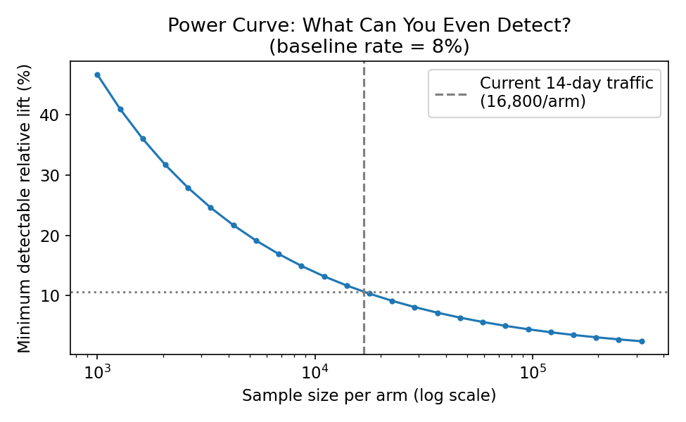
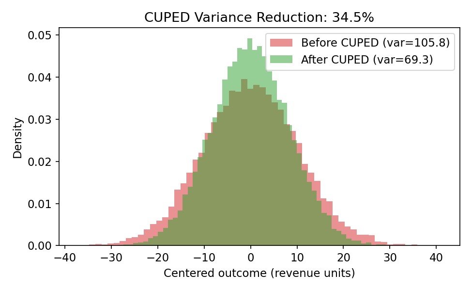
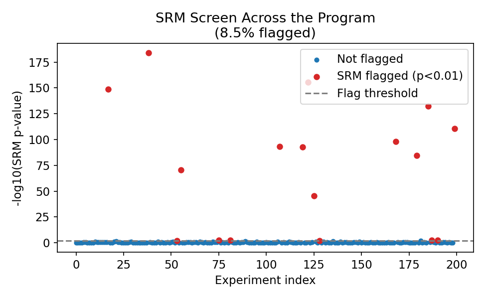

<div align="center">



# EXPERIMENT AUTOPSY

### A statistical reliability audit for A/B experiments

**Can you trust the winner?** A reproducible Python simulation framework that stress-tests experiment decisions against known ground truth.

<p>
  <a href="dashboard.html"><strong>↗ Explore the interactive dashboard</strong></a>
  &nbsp; · &nbsp;
  <a href="VP_Memo.md">Read the executive memo</a>
  &nbsp; · &nbsp;
  <a href="Experimentation_Health_Scorecard.md">View the scorecard</a>
</p>


</div>

---

## The problem

A/B tests can produce confident-looking answers for the wrong reasons: teams repeatedly inspect p-values, run underpowered experiments, evaluate many metrics, or miss randomization failures. A statistically significant result is not automatically a trustworthy decision.

**Experiment Autopsy** simulates an experimentation program with known ground truth, applies common diagnostics, and compares the decisions they produce. The project is designed to demonstrate statistical reasoning, reproducible analysis, Python engineering, and communication of business risk.

> **Important:** This is a research/portfolio prototype using synthetic data. Its results illustrate the specified simulation scenarios; they are not evidence about a real company's experimentation program or a production-ready certification of experiment validity.

## Dashboard preview

Open the [self-contained dashboard](dashboard.html) for a visual overview of the results, methods, and limitations. It is a standalone HTML file with embedded charts and no external runtime dependencies.

| False positives & stopping rules | Power & minimum detectable effect |
|:--:|:--:|
|  |  |
| **CUPED variance reduction** | **SRM diagnostics** |
|  |  |

## Key findings from the current simulation

These are illustrative outputs from the checked-in configuration, not universal rates.

| Question | Observed result | Interpretation |
|---|---:|---|
| What happens when ordinary p-values are checked daily? | **23.0%** empirical false-positive rate | Repeated unadjusted testing can inflate false positives under this simulated null scenario. |
| How did fixed-horizon testing perform? | **5.3%** empirical false-positive rate | Close to the nominal 5% target in this finite simulation. |
| What did CUPED do in the continuous-metric example? | **34.5%** variance reduction | Consistent with a high pre/post correlation of 0.6 in this particular data-generating setup. |
| How often did the novelty diagnostic catch simulated decay? | **8.3%** recall | The current diagnostic misses most simulated novelty cases; this is a limitation, not a solved capability. |
| What did checking five null metrics show? | **25.1%** at least-one-rejection rate without correction | Multiplicity can materially change the chance of a false discovery. |

The sequential mixture-test experiment currently observed a **1.5%** false-positive rate in its null simulation. Treat this as an exploratory result only: the implementation uses an approximate two-sample reduction and its sequential validity has **not** been established across a sufficiently broad calibration suite. See [limitations and methodology](docs/METHODOLOGY.md).

## What is implemented

- **Optional stopping:** compare daily significance checks with a fixed-horizon decision rule.
- **Power and MDE:** estimate required sample size and the minimum detectable relative lift at a given traffic level.
- **Sample Ratio Mismatch (SRM):** flag allocation imbalances using a chi-square diagnostic.
- **CUPED:** adjust continuous outcomes using pre-experiment covariates and measure variance reduction.
- **Multiple comparisons:** compare unadjusted testing with Benjamini–Hochberg correction.
- **Sequential testing prototype:** explore mixture-likelihood monitoring; explicitly treated as experimental pending broader calibration.
- **Novelty/decay diagnostics:** test whether early and late treatment effects differ.
- **Health scorecard and executive memo:** translate simulation outputs into risks, caveats, and recommended process controls.

## Repository map

```text
experiment-autopsy/
├── experiment_autopsy/       # Reusable statistical methods
├── tests/                    # Unit and behavior tests
├── charts/                   # Generated figures used in the report
├── docs/
│   └── METHODOLOGY.md        # Assumptions, validation and limitations
├── dashboard.html            # Self-contained visual dashboard
├── run_analysis.py           # Regenerate simulation outputs
├── make_charts.py            # Regenerate figures
├── program_results.csv       # Per-experiment simulated results
├── results.json              # Summary metrics
├── VP_Memo.md                # Decision-maker summary
└── Experimentation_Health_Scorecard.md
```

## Quick start

Python 3.9 or later is recommended.

```bash
git clone <YOUR_GITHUB_REPOSITORY_URL>
cd experiment-autopsy

python -m venv .venv
# macOS/Linux
source .venv/bin/activate
# Windows PowerShell: .venv\Scripts\Activate.ps1

python -m pip install --upgrade pip
pip install -e ".[dev]"

# Run the tests
python -m pytest -q

# Reproduce the simulation, charts, and scorecard
python run_analysis.py
python make_charts.py
python -m experiment_autopsy.scorecard
```

The analysis scripts write outputs relative to the repository root. Run them from that directory. A complete run regenerates `results.json`, `program_results.csv`, the six chart PNGs, and the Markdown scorecard.

## How to evaluate this project

A strong review should ask not only whether the code runs, but whether the statistical conclusions are calibrated. The test suite checks implementation behavior; it does **not** prove every method's theoretical guarantees.

Suggested next validation steps:

1. Run repeated-seed calibration studies and report confidence intervals for empirical type I error and power.
2. Compare power/MDE calculations with Monte Carlo benchmarks, especially for sparse outcomes.
3. Evaluate SRM under subtle imbalances and different intended allocation ratios.
4. Benchmark CUPED using treatment-effect estimator variance, not only pooled adjusted outcome variance.
5. Replace or formally validate the sequential-testing prototype before using it for real decisions.

See [`docs/METHODOLOGY.md`](docs/METHODOLOGY.md) for the simulation design and known limitations.

## Tech stack

Python · NumPy · pandas · SciPy · Matplotlib · pytest · HTML/CSS

## Project status

**Portfolio-ready as a transparent simulation and diagnostics prototype. Not production-ready for making live experiment decisions.** The next milestone is statistical calibration, not adding more methods.

## License

MIT. See [`LICENSE`](LICENSE).
